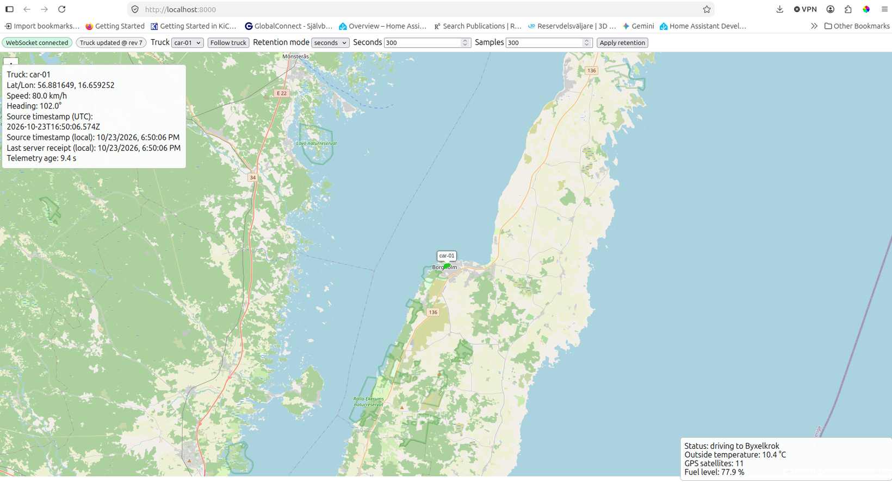

# Live Truck Map (LAN v1)

[](https://github.com/teddycool/telemetry2map-demo/actions/workflows/ci.yml)


A local-network telemetry to map demo using Flask + Flask-Sock native RFC6455 websockets.




## Easiest GitHub run (app + test-data replay + browser)

```bash
git clone <YOUR_GITHUB_REPO_URL>
cd <YOUR_REPO_FOLDER>
python3 scripts/run_demo.py
```

What this does:

- Builds and starts `app` via Docker Compose.
- Waits for `/healthz`.
- Opens your default browser at `http://localhost:8000`.
- Replays `test-data/borgholm-byxelkrok.jsonl` to `/ws/v1/ingest` with fresh timestamps/message IDs and live progress output.

Helpful options:

```bash
# Fast demo: send 30 points, one per second, then keep app running
python3 scripts/run_demo.py --interval 1 --limit 30

# Full real-time replay (10 seconds per point)
python3 scripts/run_demo.py --interval 10

# Auto-stop containers when replay exits
python3 scripts/run_demo.py --down-on-exit
```

## Architecture

1. Producers send telemetry to `/ws/v1/ingest`.
2. Server validates, stores latest truck state + bounded trace in memory, and assigns a monotonic revision.
3. Browser clients connect to `/ws/v1/events`, receive a full snapshot, then ordered live events.
4. HTTP APIs (`/api/v1/state`, `/api/v1/settings`) expose diagnostics/configuration.
5. A simulator publishes deterministic multi-truck telemetry for local demos.

### Important v1 limits

- LAN-only, no authentication, no persistence.
- In-memory process-local state: run Gunicorn with **one worker** only.
- Multi-worker/replica deployments are unsupported in v1 without shared state + pub/sub.

## Quick start (Docker Compose)

```bash
cp .env.example .env
docker compose up --build -d app simulator
# Open http://localhost:8000 or http://<host-LAN-IP>:8000
docker compose logs -f app simulator
docker compose --profile test run --build --rm tests
docker compose --profile browser-test run --build --rm browser-tests
docker compose down
```

## Run app without simulator

```bash
docker compose up --build -d app
```

## HTTP endpoints

- `GET /`
- `GET /healthz`
- `GET /api/v1/state`
- `GET /api/v1/settings`
- `PATCH /api/v1/settings`

See `docs/openapi.yaml` for schema.

## WebSocket protocol

See `docs/protocol.md` and JSON schemas in `docs/schemas`.

Example telemetry:

```json
{
  "type": "telemetry",
  "version": 1,
  "message_id": "sim-a-000042",
  "truck_id": "truck-a",
  "timestamp": "2026-10-23T12:34:56.123Z",
  "position": {"latitude": 57.7201, "longitude": 16.9402},
  "speed_kmh": 42.5,
  "heading_deg": 125.0,
  "info": ["Status: driving", "Load: test cargo", "Temperature: 18 °C"]
}
```

Example ACK:

```json
{"type":"ack","version":1,"message_id":"sim-a-000042","truck_id":"truck-a","status":"accepted","revision":42,"received_at":"2026-10-23T12:34:56.140Z"}
```

Example error:

```json
{"type":"error","version":1,"message_id":null,"code":"invalid_payload","message":"position.latitude must be between -90 and 90"}
```

## Retention semantics

- `trace_mode=seconds`: retain points by server `received_at` age.
- `trace_mode=samples`: retain newest N points.
- `HARD_TRACE_CAP` always applies in both modes.
- Increasing retention does not restore already-pruned samples.

## Key configuration

- `GUNICORN_THREADS` (default `32`)
- `TRACE_MODE`, `TRACE_SECONDS`, `TRACE_SAMPLES`, `STALE_AFTER_SECONDS`
- `MAX_MESSAGE_BYTES` (default `65536`)
- `MAX_FUTURE_SKEW_SECONDS` (default `30`)
- `MAX_TRUCKS` (default `100`)
- `HARD_TRACE_CAP` (default `3600`)

See `.env.example`.

## Tests

- Unit tests: state + validation + retention semantics.
- Integration tests: real Gunicorn + HTTP + websocket ingest/events.
- Browser test (Playwright): UI rendering, info-box replacement, safe text rendering with tile stubbing.

## OSM tile policy

Default tiles use `https://tile.openstreetmap.org/{z}/{x}/{y}.png` with attribution shown in-map.
Follow: [OSM tile usage policy](https://operations.osmfoundation.org/policies/tiles/).

## Troubleshooting

- Frequent event websocket reconnects: inspect `app` logs and verify one-worker deployment.
- Stale markers: stale means no recent accepted telemetry; sender connectivity and freshness are separate.
- Empty map with controls visible: check telemetry ingest and `/api/v1/state`.
- Missing tiles: map remains usable but background tiles may be unavailable.
